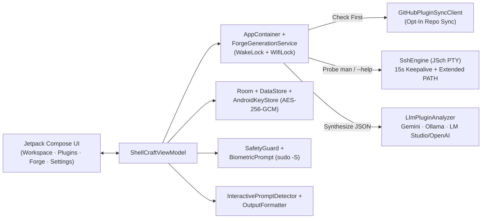

<div align="center">

# ShellCraft

**AI-Powered CLI-to-GUI Control Plane & Interactive SSH Engine for Android**

[-3DDC84?style=for-the-badge&logo=android&logoColor=white)](#quick-start)
[](#project-structure)
[](#core-features)
[](docs/PLUGIN_ARCHITECTURE.md)

Turn any POSIX, Linux, macOS, or Windows OpenSSH command-line tool into a consistent, interactive Material 3 graphical interface — packaged as portable JSON plugins, synced via GitHub, and guarded by biometric `sudo` authorization.

</div>

---

## Table of Contents

- [Overview](#overview)
- [Architecture](#architecture)
- [Core Features](#core-features)
- [Plugin Synthesis Pipeline](#plugin-synthesis-pipeline)
- [Interactive Shell & Smart Output](#interactive-shell--smart-output)
- [Documentation Suite](#documentation-suite)
- [Quick Start](#quick-start)
- [Project Structure](#project-structure)
- [Verification & Testing](#verification--testing)

---

## Overview

Working with complex CLI tools from a mobile screen usually means typing fragile flags into tiny terminal emulators. **ShellCraft** solves this by connecting to remote systems over SSH, probing a command's `man` page and `--help` output (or analyzing pasted docs), and compiling a structured **`shellcraft.plugin.v1`** GUI manifest using your choice of **cloud or self-hosted LLM backend**.

Once generated, plugins render native Material 3 controls — action mode cards, numeric/port steppers, segmented enum chips, quick POSIX path pills, switches, and safety badges — with deterministic POSIX quoting and live interactive terminal execution.

---

## Architecture



---

## Core Features

| Area | Capabilities |
| :--- | :--- |
| **SSH Execution Engine** | Password and OpenSSH/PEM private key auth (passphrase supported), extended POSIX `PATH`/`MANPATH` (macOS Apple Silicon `/opt/homebrew/bin`, Intel `/usr/local/bin`, Linuxbrew, `~/.local/bin`, `sbin`), 15-second keepalive heartbeat with live RTT latency badge, and one-tap reconnect. |
| **Configurable LLM Backends** | Supports **Firebase AI Logic (Gemini)** with structured JSON schema output, **Local Ollama** (`/api/chat` NDJSON streaming), and **OpenAI-Compatible** endpoints such as LM Studio or vLLM (`/v1/chat/completions` SSE streaming with `reasoning_content` progress tracking). |
| **Sleep-Resilient Forge Pipeline** | Long-running local reasoning models run in an app-scoped coroutine paired with a `WakeLock`, high-performance `WifiLock`, `FLAG_KEEP_SCREEN_ON`, an optional `dataSync` foreground notification, configurable timeouts (`60s`–`480s`), and a one-tap **Stop** control. |
| **Interactive PTY & Stdin Prompts** | Allocates a `vt100` PTY for remote commands, detects `[y/N]`, `(yes/no)`, `Password:`, `Press Enter`, and custom stalled prompts in real time, and exposes one-tap confirmation buttons, masked secret inputs, `Ctrl+C`, and `Ctrl+D`. |
| **Smart Output Rendering** | Automatically formats ping reports, `systemd` service status cards, columnar tables (`docker ps`, `df -h`, `ps`), pretty-printed JSON summaries, key-value metrics, and severity-highlighted log lines alongside a raw view toggle. |
| **Safety & Biometric Sudo** | Multi-tier risk classification (`SAFE`, `MODERATE`, `HIGH`, `CRITICAL`), destructive command interception (`rm -rf`, `mkfs`, `shutdown`, `curl \| sh`), Android `BiometricPrompt` gating, and ephemeral `sudo -S` stdin password piping. |
| **Opt-In GitHub Sync** | Checks your configured GitHub repository (`plugins/<commandName>.json`) *before* calling an LLM to avoid redundant generation. Supports `AUTOMATIC`, `INTERVAL_HOURLY`, `INTERVAL_DAILY`, `ON_SSH_CONNECT`, and `MANUAL_ONLY` policies, defaulting to local Room storage when unconfigured. |
| **Tactile & Adaptive UI** | Spring-scale press animations, ambient `GlowSurfaceCard` status surfaces, system haptics across controls/warnings, `NavigationBar` on phones and `NavigationRail` on tablets/foldables. |

---

## Plugin Synthesis Pipeline

When you tap **Check Repo & Generate GUI Plugin** in the **Forge** tab:

1. **GitHub Check-Before-Generate** — If GitHub sync is enabled, ShellCraft checks `plugins/<command>.json` in your configured repo/branch first. It also checks local Room storage so existing plugins load with **zero LLM cost**.
2. **Documentation Acquisition** — Either probes the connected SSH host (`command -v`, `--version`, `--help`, and `man` with Homebrew `MANPATH` support) or analyzes pasted manual documentation.
3. **Streaming LLM Synthesis** — Sends the docs and OS hint to your selected LLM backend, streaming progress live to the 4-stage pipeline stepper (`Repo` → `Docs` → `AI Synth` → `GUI Ready`).
4. **Validation & Local/Remote Save** — Normalizes OS targets, parameter types, and subcommands into a `shellcraft.plugin.v1` manifest ready for immediate execution and optional GitHub publishing.

---

## Interactive Shell & Smart Output

Commands do not run blind inside a one-way pipe:

- **Bidirectional PTY**: Remote commands run inside a `vt100` pseudo-terminal so tools flush prompts cleanly and accept ongoing stdin replies.
- **Prompt Classifier**: `InteractivePromptDetector` monitors trailing output (and `450ms` stream pauses on incomplete lines) to render contextual quick-reply bars (`Yes (y)` / `No (n)`, `Press Enter ↵`, or masked password inputs that never echo secrets into logs).
- **Structured Views**: Completed output passes through `OutputFormatter` + `RichCommandOutputView` to display dedicated UI cards for ping latency/loss, `systemctl status`, tables, JSON, key-value pairs, or color-coded logs.

---

## Documentation Suite

| Document | Description |
| :--- | :--- |
| [**Plugin Architecture & SDK Spec**](docs/PLUGIN_ARCHITECTURE.md) | Complete `shellcraft.plugin.v1` schema reference, parameter controls, interactive prompt contract, POSIX quoting rules, and third-party/agent contribution guide. |
| [**Security & Biometric Sudo Model**](docs/SECURITY_MODEL.md) | Deep dive into `AndroidKeyStore` AES-256-GCM credential encryption, `SafetyGuard` risk rules, `BiometricPrompt` gating, and ephemeral `sudo -S` execution. |
| [**LLM Backends & Sleep Resilience**](docs/LLM_BACKENDS.md) | Step-by-step setup for Firebase AI Logic Gemini, Ollama, and LM Studio / OpenAI-compatible servers, reasoning-model timeout tuning, and background WakeLock behavior. |
| [**Same-Repo Plugins Guide**](plugins/README.md) | How to store and sync `plugins/<commandName>.json` directly inside the same GitHub repository as this app. |

---

## Quick Start

### 1. Build & Run
1. Open the project in Android Studio (or run via Gradle CLI with `gradle assembleDebug` — note this environment uses system `gradle`).
2. Install on a device/emulator running **Android 7.0+ (API 24+)**, targeting **API 36**.
3. *(Optional)* If using **Firebase AI Logic (Gemini)** on a physical phone sideloaded with a debug APK, register the `DebugAppCheckProviderFactory` debug token printed in Logcat inside the Firebase Console under **App Check** (or switch to a local Ollama / OpenAI-compatible server in **Settings**).

### 2. Configure Workspace & Backends
1. **Workspace Tab**: Add an SSH endpoint (`host`, `port`, `username`, password or OpenSSH/PEM private key) and tap **Connect**.
2. **Settings Tab**:
   - Choose your **LLM Backend** (`Firebase Gemini`, `Ollama Local`, or `OpenAI-Compatible`) and tap **Test Connection**.
   - *(Optional)* Enable **GitHub Plugin Repository**, enter `owner/repo`, branch (default `main`), directory (default `plugins`), sync policy, and an optional fine-grained PAT (`Contents: Read & Write`) to publish generated plugins.
3. **Forge Tab**: Enter any CLI command (e.g. `brew`, `ping`, `ufw`, `docker`, `nmap`), synthesize its GUI, and save/launch it immediately.

---

## Project Structure

```text
.
├── README.md
├── docs/
│   ├── PLUGIN_ARCHITECTURE.md      # shellcraft.plugin.v1 spec & agent/developer guide
│   ├── SECURITY_MODEL.md           # Keystore encryption, SafetyGuard & Biometric sudo
│   └── LLM_BACKENDS.md             # Gemini, Ollama, LM Studio & timeout/streaming guide
├── plugins/
│   └── README.md                   # Same-repo plugin directory guide
└── app/src/main/java/com/snehashis/
    ├── MainActivity.kt             # Edge-to-edge host + App Check bootstrap
    ├── core/
    │   ├── AppContainer.kt         # Process-wide pipeline scope, WakeLock/WifiLock
    │   └── security/               # SecretCipher, SafetyGuard, BiometricAuthHelper, Haptics
    ├── domain/model/               # CliPlugin, PluginCommandBuilder, OutputFormatter, PromptDetector
    ├── data/
    │   ├── local/                  # Room database, DAOs, SeedPlugins, SettingsDataStore
    │   ├── ssh/                    # SshEngine (JSch PTY, keepalive, extended POSIX PATH)
    │   ├── llm/                    # LlmPluginAnalyzer (Gemini, Ollama, OpenAI SSE streaming)
    │   ├── github/                 # GitHubPluginSyncClient (Contents API lookup & publish)
    │   └── repository/             # ShellCraftRepository
    ├── service/
    │   └── ForgeGenerationService.kt # Sleep-resilient notification companion service
    └── ui/
        ├── theme/                  # Material 3 ColorScheme, bundled TTF Typography, Shapes
        ├── components/             # GlowSurfaceCard, RichOutputRenderer, Terminal & Safety sheets
        └── screens/                # WorkspaceScreen, PluginsScreen, PluginRunnerScreen, ForgeScreen, SettingsScreen
```

---

## Verification & Testing

Run the local JVM unit and Robolectric Compose/Service test suite:

```bash
gradle :app:testDebugUnitTest
```

Covered suites:
- **`ShellCraftCoreTest`** — Deterministic POSIX quoting, command & `sudo` assembly, `SafetyGuard` risk rules, `OutputFormatter` parsers (`ping`, `systemctl`, tables, JSON, key-value, log severity), `SshEngine` extended Homebrew/POSIX PATH wrapping, and `InteractivePromptDetector` classification.
- **`ExampleRobolectricTest`** — App context resources, `ForgeGenerationService` foreground companion notification validation on SDK 36, and Compose UI Forge button interaction.
