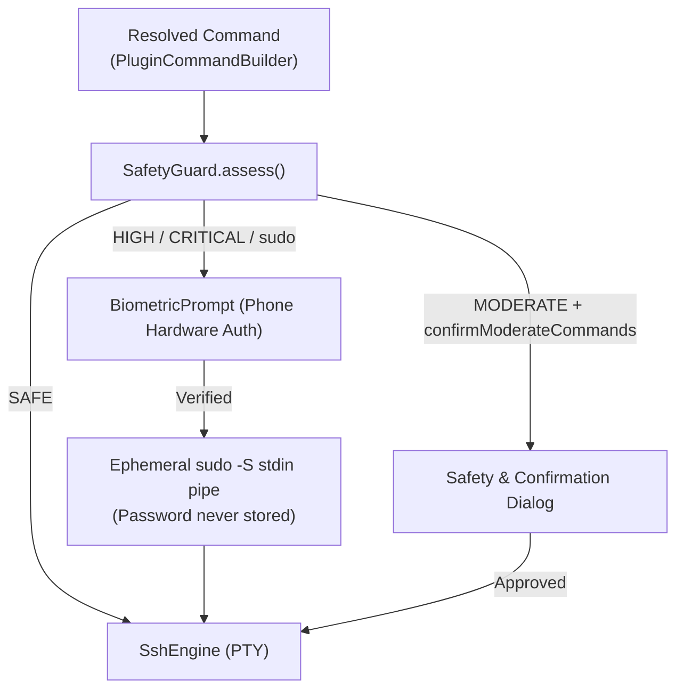

# ShellCraft Security & Biometric Sudo Model

Executing remote system administration commands from a mobile device demands defense-in-depth at every boundary: credential storage, command construction, risk gating, privilege escalation, and interactive secret handling.

---

## Security Architecture Summary

---

## 1. Hardware-Backed Credential Encryption (`SecretCipher`)

All sensitive credentials stored locally on-device are encrypted before hitting Room (`ShellCraftDatabase`) or Preferences `DataStore` (`SettingsDataStore`):

- **Algorithm**: `AES-256-GCM` (`AES/GCM/NoPadding`) with a `128-bit` authentication tag and fresh random IV per encryption.
- **Key Storage**: Key material (`shellcraft_secrets_aes_key`) is generated and held inside **`AndroidKeyStore`** and never exported to app storage.
- **Protected Secrets**:
  - SSH passwords (`encryptedPassword`)
  - OpenSSH / PEM private keys (`encryptedPrivateKey`)
  - Private key passphrases (`encryptedKeyPassphrase`)
  - Custom LLM endpoint bearer API keys (`encryptedApiKey`)
  - GitHub Personal Access Tokens (`encryptedPat`)

---

## 2. Pre-Execution Risk Assessment (`SafetyGuard`)

Before any command reaches the SSH transport, `SafetyGuard.assess(...)` evaluates both the manifest's declared `PluginAction.riskLevel` and regex inspections of the fully assembled command string:

| Risk Level | Trigger Examples | Enforcement Behavior |
| :--- | :--- | :--- |
| **`CRITICAL`** | `rm -rf`, `mkfs`, `fdisk`, `parted`, `wipefs`, `dd`, `shutdown`, `reboot`, `poweroff`, `halt`, raw device redirection (`> /dev/sd*`), remote pipe-to-shell (`curl \| sh`) | **Mandatory explicit confirmation dialog** with elevated red warnings (cannot be disabled in Settings). |
| **`HIGH`** | Any `sudo` / `doas` / `su` invocation, `kill -9`, `killall`, `pkill -9`, `chmod 777`, `chown -R`, `prune`, `purge`, `drop`, `truncate`, `reset --hard`, `iptables`, `ufw disable`, `systemctl stop/disable/mask` | **Mandatory confirmation dialog** + superuser authorization when elevated. |
| **`MODERATE`** | `systemctl restart`, `docker rm/stop/restart`, `apt remove/purge`, or compound shell operators (`;`, `&&`, backticks, `$()`) | Confirmation dialog controlled by **Confirm Moderate Risk Commands** toggle in Settings (enabled by default). |
| **`SAFE`** | Read-only inspection commands (e.g. `docker ps`, `systemctl status`, `journalctl`) | Executes immediately with a light confirmation haptic. |

---

## 3. Manual Biometrics & Ephemeral `sudo -S` Elevation

Superuser execution is never silent or cached permanently:

1. **Biometric Gate (`BiometricAuthHelper`)**:
   - Uses AndroidX `BiometricPrompt` supporting `BIOMETRIC_STRONG`, `BIOMETRIC_WEAK`, or `DEVICE_CREDENTIAL` fallback when **Require Biometrics for `sudo`** is enabled.
   - The **Authorize & Run** action stays locked until device biometric/PIN verification succeeds.
2. **Ephemeral Stdin Injection (`SshEngine`)**:
   - Remote `sudo` commands are rewritten to `sudo -S -p '' <command>` so `sudo` reads the password strictly from `stdin` without echoing a prompt.
   - The password exists only in transient memory for that single command invocation and is **never persisted** to Room, DataStore, or execution logs.
   - If the remote user uses `NOPASSWD`, leaving the password field blank still enforces local biometric verification before execution.

---

## 4. Non-Echoing Interactive Secret Prompts

During interactive PTY execution:

- When `InteractivePromptDetector` matches a secret prompt (`Password:`, `Enter passphrase:`, `[sudo] password`, `PIN:`, `OTP:`), the UI automatically switches the input control to masked `PasswordVisualTransformation` (`KeyboardType.Password`).
- Submitting a secret writes directly to the active channel's `OutputStream` and records `> [secret sent]` in the local terminal log rather than plaintext credentials.

---

## 5. POSIX Shell Injection Defense

`PluginCommandBuilder` avoids string-interpolating unescaped user inputs into shell pipelines:
- Subcommands are split cleanly into tokens.
- Values containing spaces, quotes, semicolons, command substitutions, or redirection characters are wrapped via `posixQuote()` using single-quote escaping (`'...'` with `'"'"'` for literal single quotes).
- Compound operators (`;`, `&&`, backticks, `$()`) trigger an automatic `SafetyGuard` warning before running.
